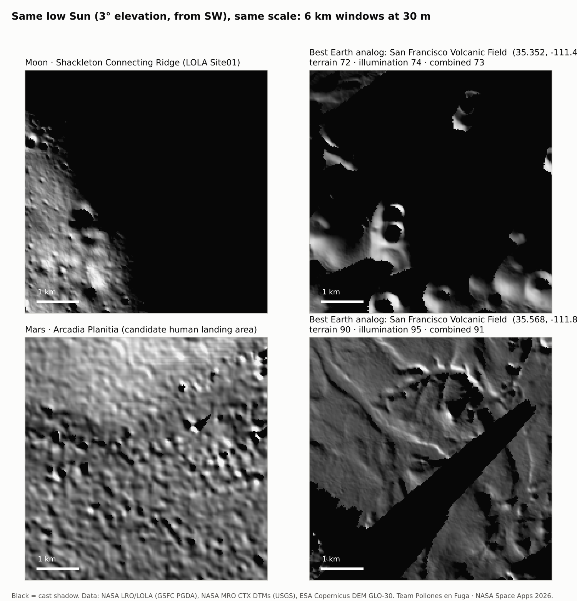
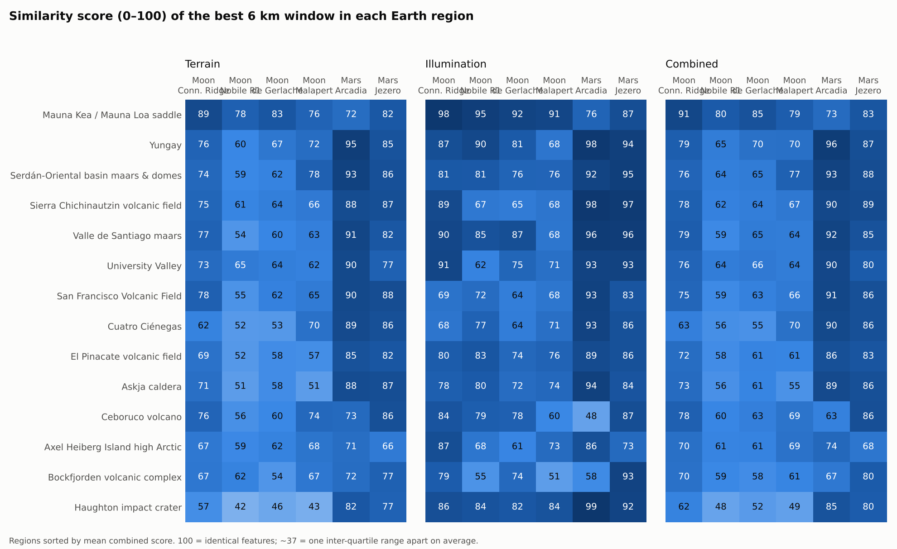

# P.E.N. 🌗
### Planetary Environmental Navigator

**Team:** Pollones en Fuga (Mexico) · **NASA Space Apps Challenge 2026 · Challenge:** *Identify Earth Locations that Analog the Permanent Moon Base Locations and Mars*

P.E.N. finds the **exact field-test site on Earth** for the planned **lunar south-pole Moon Base** and for
candidate **Mars landing areas**. It scores 6 km windows at 30 m resolution, **one dimension at a time**. Today
those dimensions are terrain and **low-Sun illumination**; thermal and ice from LRO Diviner are next. For each
candidate it says *how* similar it is, *in what*, and *where the analogy breaks*.

> **Why light?** At the lunar south pole the Sun never rises above ~7°. Long shadows define landing safety,
> rover vision, power and EVA planning. P.E.N. scores **terrain-cast shadows** with an exact shadow model and
> **validates them against NASA's official LOLA illumination maps** (Spearman ρ = 0.86 at Shackleton Connecting Ridge).
> It also finds **when** Earth sites reproduce lunar-pole light (an *analog in time*), not only **where**.

**Where it fits:** regional screeners tell you *which region* of Earth to look at, on ~50 km cells. P.E.N.
is the zoom-in stage: *which 6 km site* inside that region matches the target's terrain and light, compared against
the official 5 m LOLA DEMs of the Moon Base sites.



## Key results (v0.1, 6 km windows, 30 m grid)

| Reference | Best Earth window | Combined | Terrain | Illumination |
|---|---|---|---|---|
| Moon · Shackleton Connecting Ridge | San Francisco Volcanic Field, AZ (35.352, −111.441) | 73 | 72 | 74 |
| Moon · Shackleton Connecting Ridge | El Pinacate, Sonora, MX (31.785, −113.497) | 72 | 70 | 81 |
| Moon · Malapert Massif | Cuatro Ciénegas, Coahuila, MX (26.567, −102.039) | 70 | 68 | 74 |
| Mars · Arcadia Planitia | San Francisco Volcanic Field, AZ | 91 | 90 | 95 |
| Mars · Jezero | Cuatro Ciénegas, MX | 84 | 84 | 83 |

- **Validation:** our shadow model reproduces the official LOLA 18.6-year average-illumination map at Connecting
  Ridge (Spearman ρ = 0.86). Agreement is weaker at Malapert (ρ = 0.55), where distant horizons outside the local DEM matter.
- **Analog in time:** Haughton crater (75° N) gives 4–6 h/day of lunar-pole-like low Sun (0–7°) in Mar–May and
  Aug–Oct. The Mexican and Arizona sites get only ~1.1–1.3 h/day.



## Quick start

```bash
git clone <this repo> && cd pen
python -m venv .venv && source .venv/bin/activate    # Windows: .venv\Scripts\activate
pip install -r requirements.txt
streamlit run app/streamlit_app.py                   # uses the committed results in data/processed/
```

Reproduce everything from raw data (~300 MB download, ~5 min compute):

```bash
make data        # python scripts/download_data.py
make pipeline    # python scripts/run_pipeline.py
make validate    # python scripts/validate_illumination.py
make figures     # python scripts/make_figures.py
make test        # pytest
```

Add an Earth region: copy a `candidate` block in [`config/sites.yaml`](config/sites.yaml) with its Copernicus tile,
then run `make data pipeline figures`.

## How it works

1. **Common grid:** every DEM (Moon LOLA 5 m, Mars CTX 20 m, Earth Copernicus 30 m) is reprojected to a local
   azimuthal-equidistant grid at 30 m, using each body's radius.
2. **Windows:** each grid is cut into 3, 6 and 12 km windows, with a step of half a window.
3. **Features per window:**
   - *Terrain:* relief (P98−P2), median and P90 slope, 150 m roughness, hypsometric integral.
   - *Illumination:* fraction of the window in cast shadow with the Sun at 2° and 5°, averaged over 8 azimuths.
     The algorithm is exact and runs in O(N) per row: pixel *i* is shadowed iff `max_{j<i}(z_j + j·dx·tanθ) > z_i + i·dx·tanθ`.
4. **Scores:** each feature difference is scaled by the IQR of all Earth windows. The scaled differences are
   combined into an RMS distance *D*, and the score is `S = 100·exp(−D)`, reported per dimension and combined.
5. **Explainability:** every window gets a card listing what is *similar*, what *differs*, and what *Earth cannot
   reproduce* (gravity, vacuum, radiation …).

Details and limitations: [`docs/METHOD.md`](docs/METHOD.md).

## Data (all open)

| Data | Agency | Use |
|---|---|---|
| [LOLA 5 m south-pole DEMs](https://pgda.gsfc.nasa.gov/products/78) (Barker et al.) | **NASA** GSFC / LRO | Moon Base reference terrain |
| [LOLA polar illumination](https://pgda.gsfc.nasa.gov/products/69) (Mazarico et al.) | **NASA** GSFC / LRO | Validation of the shadow model |
| [MRO CTX stereo DTMs](https://stac.astrogeology.usgs.gov/docs/data/mars/ctxdtms) | **NASA** MRO / USGS | Mars reference terrain |
| [Copernicus DEM GLO-30](https://registry.opendata.aws/copernicus-dem/) | **ESA** (Space Agency Partner) | Earth candidate terrain |

Planned: LRO Diviner polar temperatures (NASA), EMIT surface mineralogy (NASA), MODIS/ECOSTRESS land-surface temperature (NASA),
RADARSAT / Sentinel-1 radar (CSA / ESA).

## Limitations

- Shadows come from **local** terrain only. There is no body curvature and no horizon outside the DEM, which is why
  agreement drops at Malapert.
- Copernicus is a surface model: vegetation and buildings are included.
- Flat Mars plains score high against much of Earth. Plains need finer texture, ice or thermal features to discriminate.
- Rankings depend on window size; see `stability_top10_by_window_km` in `data/processed/results.json`.
- Earth cannot reproduce reduced gravity, vacuum, the thin CO₂ atmosphere or the radiation environment.

## Use of AI

In line with the Space Apps rules, we disclose that the team used an AI assistant (Claude, by Anthropic) to:
gather background literature and dataset links, draft and refactor parts of the Python code, and draft documentation.
Every file with AI-assisted code says so in its header. The team decided the approach and the site choices, ran
and checked all results, and owns every claim in this repository. No AI-generated images are used: every figure is
plotted directly from the data by the scripts in `scripts/`.

## Team

**Pollones en Fuga** — Victor · Diego Lizárraga · Diego Doña · Angel · Aaron · Paul. A Mexican team; El Pinacate (Sonora), where Apollo astronauts trained, is one of the analogs P.E.N. ranks highest for the Moon Base. Roles: [`docs/TEAM.md`](docs/TEAM.md).

## License

Code: MIT ([LICENSE](LICENSE)). Data belong to their providers. NASA data are public domain; Copernicus DEM ©
DLR e.V. / Airbus, provided under the Copernicus programme by ESA.
