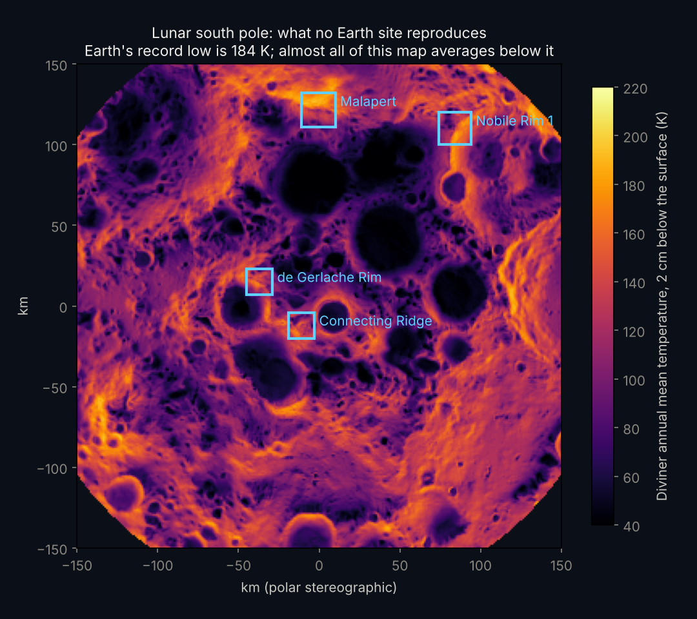
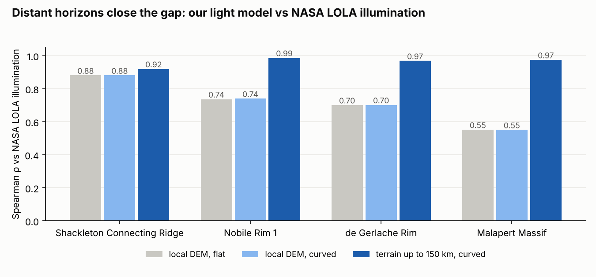
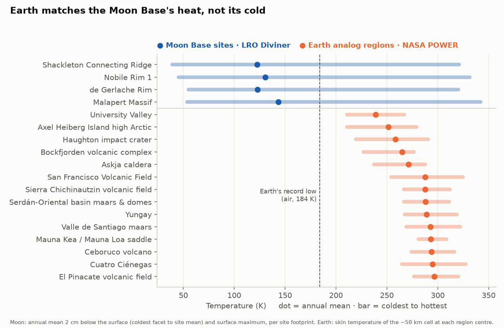

# P.E.N. 🌗
### Planetary Environmental Navigator

**Team:** Pollones en Fuga (Mexico) · **NASA Space Apps Challenge 2026 · Challenge:** *Identify Earth Locations that Analog the Permanent Moon Base Locations and Mars*

P.E.N. finds the **exact field-test site on Earth** for the planned **lunar south-pole Moon Base** and for
candidate **Mars landing areas**. It scores 6 km windows at 30 m resolution, **one dimension at a time**. Today
those dimensions are terrain and **low-Sun illumination**, searched across **14 Earth regions** (~10,400 windows).
For each candidate it says *how* similar it is, *in what*, and *where the analogy breaks*, with NASA LRO Diviner
temperature and ice data quantifying that last part for the Moon sites. Every analog card also shows the **real view**
of both sites from NASA imagery APIs and a **live field-safety check** from NASA EONET.

> **Why light?** At the lunar south pole the Sun never rises above ~7°. Long shadows define landing safety,
> rover vision, power and EVA planning. P.E.N. scores **terrain-cast shadows** with an exact shadow model and
> **validates them against NASA's official LOLA illumination maps**: with distant horizons included, Spearman
> ρ = 0.92–0.99 at all four Moon Base sites, with a mean error of 2.0–3.2 percentage points of lit time.
> It also finds **when** Earth sites reproduce lunar-pole light (an *analog in time*), not only **where**.

**Where it fits:** regional screeners tell you *which region* of Earth to look at, on ~50 km cells. P.E.N.
is the zoom-in stage: *which 6 km site* inside that region matches the target's terrain and light, compared against
the official 5 m LOLA DEMs of four Moon Base sites, three of them inside NASA's Artemis candidate landing regions.


## Key results (v0.3, 6 km windows, 30 m grid, 6 targets, 14 Earth regions, 10,424 windows)

| Reference | Best Earth window | Combined | Terrain | Illumination |
|---|---|---|---|---|
| Moon · Shackleton Connecting Ridge | Mauna Kea upper slopes, Hawaiʻi (19.811, −155.544) | 91 | 89 | 98 |
| Moon · de Gerlache Rim | Mauna Kea, Hawaiʻi (19.865, −155.516) | 85 | 83 | 92 |
| Moon · Nobile Rim 1 (Artemis candidate region) | Mauna Kea, Hawaiʻi (19.865, −155.516) | 81 | 78 | 95 |
| Moon · Malapert Massif (Artemis candidate region) | Mauna Kea, Hawaiʻi (19.784, −155.487) | 79 | 76 | 91 |
| Mars · Arcadia Planitia | Hyperarid Atacama near Yungay, Chile (−24.893, −69.914) | 96 | 95 | 98 |
| Mars · Jezero | Sierra Chichinautzin volcanic field, Mexico (19.323, −99.887) | 89 | 87 | 97 |

- **Blind rediscovery of a NASA lunar test site.** Pu'u Hiwahine on Mauna Kea, where NASA, CSA and DLR ran
  ISRU field tests in 2010 and 2012 (the 2012 test simulated a lunar-polar prospecting mission), is window
  **#1 of 10,424** for Malapert and stays in the **top 0.2 %** for all four Moon Base sites (#9 Nobile Rim 1,
  #19 de Gerlache, #23 Connecting Ridge). P.E.N. never saw any analog labels. For the Mars targets it ranks low,
  as a lunar site should.
- **The light model matches NASA.** With NASA's 40 m polar DEM up to 150 km away, exact lunar curvature and real Sun
  positions, our illumination reproduces the LOLA 18.6-year average-illumination map with Spearman ρ = 0.92
  (Connecting Ridge), 0.99 (Nobile Rim 1), 0.97 (de Gerlache) and 0.975 (Malapert), with a mean error of 2.0–3.2
  percentage points of lit time. With the local DEM alone ρ is 0.55–0.88: the gap was distant mountains, and
  curvature by itself barely matters.
- **Known-analog test:** 8 classic analog sites, 32 site × target tests. The median rank is the 83rd percentile for
  illumination and the 58th for terrain (50 = random). El Pinacate, the Apollo training ground in Sonora, ranks in
  the top 3 % for all four Moon Base sites. Sites chosen for other reasons rank lower, as they should: Meteor Crater
  is an impact-geology analog, University Valley a dry-permafrost (thermal) analog, and Yungay a chemical and
  aridity analog, not a terrain or light one.
- **Where Earth stops being an analog:** per LRO Diviner, in 88–100 % of each lunar site the annual mean
  temperature (2 cm below the surface) is colder than the lowest air temperature ever measured on Earth (184 K,
  Vostok), and water ice is thermally stable within 1 m in 22–40 % of it. Surface peaks reach 320–342 K.
- **Diviner vs Earth's cold analogs** (the comparison the challenge resources suggest): the coldest Earth region we
  search, University Valley in Antarctica, has a mean skin temperature of 239 K (NASA POWER). The Moon Base sites
  average 122–144 K, which is 95–116 K colder. The heat is within reach: Earth's desert regions peak at up to 328 K,
  against lunar surface peaks of 320–342 K (fig8).
- **Analog in time:** polar sites (Haughton, Axel Heiberg, Svalbard, University Valley) give 4–7 h/day of
  lunar-pole-like low Sun (0–7°) around the equinoxes; sites below 40° latitude get about 1 h/day.
- **NASA APIs in the app** ([api.nasa.gov](https://api.nasa.gov/)): Moon Trek WMTS (LRO NAC south-pole mosaic, 1 m),
  Mars Trek WMTS (CTX global mosaic) and GIBS (Landsat/HLS 30 m) give a real photo of both windows, reprojected onto
  the same grid as the low-Sun preview. EONET flags open natural events within 150 km of the Earth site; when we
  checked, it listed active wildfires 20–35 km from our best Mauna Kea window.
- **Robustness:** re-weighting illumination 0.5–2× keeps 8–10 of the top 10 for five of the six targets (5–10 for
  Malapert). Window size (3/6/12 km) changes rankings much more; we report it instead of hiding it.


## Project status (Sat Nov 14, 15:30 local · freeze Sun 12:00 · submit Sun 18:00)

**Done**

| What | Where | Area owner |
|---|---|---|
| Common 30 m grid for Moon, Mars and Earth; Earth sea/lake mask | `pen/grid.py` | Victor |
| Exact O(N) cast-shadow model, 2 Sun elevations × 8 azimuths | `pen/shadows.py` | Victor |
| Terrain + illumination features, IQR-scaled similarity, per-dimension scores | `pen/features.py`, `pen/scoring.py` | Victor |
| 6 references (4 Moon Base sites incl. Artemis candidates Nobile Rim 1 and Malapert, 2 Mars) and 14 Earth regions | `config/sites.yaml` | D. Lizárraga · D. Dona |
| Light model vs NASA LOLA illumination, local (ρ 0.55–0.88) and with 150 km horizons + curvature (ρ 0.92–0.99) | `scripts/validate_illumination.py`, `scripts/validate_far_horizons.py`, fig4, fig7 | D. Lizárraga · Victor |
| Known-analog test with 8 classic sites (Mauna Kea ISRU site #1 for Malapert, top 0.2 % for all Moon sites) | `scripts/validate_known_analogs.py` | D. Dona |
| Sensitivity to weights and window size | `scripts/sensitivity.py`, fig5 | Victor |
| LRO Diviner temperature and ice context for the Moon sites | `scripts/diviner_context.py`, fig6 | D. Lizárraga |
| Diviner vs Earth analog regions (NASA POWER skin temperature) | `scripts/thermal_gap.py`, fig8 | D. Lizárraga |
| Analog in time (hours/day of 0–7° Sun per month) | `pen/sun.py`, fig3 | Victor |
| Dark app with 3D globe / flat map, analog card with low-Sun previews, validation tab, CSV download | `app/` | Paul · Aaron |
| Far-horizon method and Diviner numbers reviewed against the NASA labels (PDS3 LDEM, AVGVISIB scale, PDS4 Diviner); `ray_reach` and the AVGVISIB scale guard added | `scripts/validate_far_horizons.py`, `scripts/diviner_context.py` | D. Lizárraga |
| Real NASA imagery for every analog card (Moon/Mars Trek WMTS, GIBS), aligned with the previews | `scripts/real_imagery.py` | Aaron · Paul |
| Live field-safety check from NASA EONET, with an offline snapshot | `pen/eonet.py`, `scripts/eonet_snapshot.py` | Aaron |
| Tests (17) and CI with an offline app smoke test | `tests/`, `.github/` | Aaron |

**To do before the freeze** (each line is a GitHub issue, see [`docs/TEAM.md`](docs/TEAM.md))

| What | Why it matters | Owner |
|---|---|---|
| Public deploy on Streamlit Community Cloud; check that EONET answers live there | The judges need a link that opens without installing anything | Aaron |
| Deck (7 slides) and project page around the blind-rediscovery result | It's the demo the judges see | Angel |
| Visual identity (wordmark), UI polish, phone check, visuals for the deck | First impression | Paul |
| Moon/Mars data paragraph for the project page | Angel needs it for the submission | D. Lizárraga |
| Earth surface temperature (MODIS/ECOSTRESS) so thermal becomes a **scored** dimension | Today Diviner is context only | D. Dona → Victor |
| Fact-check every number in README, deck and page; tag `v1.0` | No wrong number in front of judges | Angel · Victor |

**Stretch (only if time allows):** a Mars ice reference (Deuteronilus Mensae CTX DTM); the remaining Artemis regions
(Nobile Rim 2, de Gerlache Rim 2, Haworth, Mons Mouton) once 5 m DEMs are available; EMIT mineralogy for the Mexican
regions; a 30-second video.

## Quick start

```bash
git clone <this repo> && cd pen
python -m venv .venv && source .venv/bin/activate    # Windows: .venv\Scripts\activate
pip install -r requirements.txt
streamlit run app/streamlit_app.py                   # uses the committed results in data/processed/
```

Reproduce everything from raw data (~950 MB download, ~15 min compute):

```bash
make data        # python scripts/download_data.py
make pipeline    # python scripts/run_pipeline.py
make validate    # python scripts/validate_illumination.py
make figures     # python scripts/make_figures.py
make extras      # thumbnails, known-analog test, sensitivity, Diviner context, thermal gap
make far         # far-horizon light validation (~4 min, needs the 230 MB LOLA polar DEM)
make imagery     # real NASA imagery for the analog cards (Trek WMTS + GIBS, ~150 requests, no API key)
make eonet       # refresh the offline EONET snapshot
make test        # pytest
```

Add an Earth region: copy a `candidate` block in [`config/sites.yaml`](config/sites.yaml) with its Copernicus tile,
then run `make data pipeline figures extras`.

## The algorithm (exactly what the code does)

Everything below is implemented in `pen/` and run by `scripts/run_pipeline.py`. The full run takes ~9 min on 2 CPU
cores (~50 s per 1° × 1° Earth tile).

**1 · Common grid** (`pen/grid.py`). Each DEM is reprojected with `rasterio` to a local azimuthal-equidistant
projection centred on the DEM, using the body's own shape (Moon sphere R = 1,737,400 m, Mars sphere
R = 3,396,190 m, Earth WGS84), and **averaged** to 30 m pixels. The 5 m LOLA and 20 m CTX DTMs are therefore
degraded to Copernicus resolution, so all bodies are compared at the same scale.
On Earth only, before reprojecting, two kinds of pixel become NaN: sea (z ≤ 0.5 m) and lakes (pixels whose 5 × 5
neighbourhood has max − min = 0, because Copernicus flattens water bodies). Otherwise both look like perfect
"Mars plains".

**2 · Cast shadows** (`pen/shadows.py`). For a Sun at elevation θ coming from the left of a row with pixel size
dx, pixel *i* is in shadow if some pixel *j < i* rises above the Sun ray through *i*:

```
z_j − (i − j)·dx·tanθ > z_i        ⇔        max_{j<i} g_j > g_i ,   with  g_i = z_i + i·dx·tanθ
```

So one running maximum per row gives the **exact** shadow mask in O(N), with no maximum search distance.
Other Sun azimuths: rotate the DEM by (azimuth − 270°) so the Sun comes from the left (bilinear,
`mode="nearest"` at the edges), compute, rotate the mask back with nearest-neighbour, and crop to the original size.
NaN holes are first filled with the nearest valid height, so they don't act as fake pits, and are never counted as
shadow. For each pixel and each elevation θ ∈ {2°, 5°}, the **shadow fraction** is the share of the 8 azimuths
(0°, 45°, …, 315°) in which it is shadowed. That is 16 shadow maps per DEM.

**3 · Per-pixel terrain.** Slope = arctan(|∇z|), with the gradient from a Sobel filter divided by 8·dx.
Roughness = (z − mean of z over 5 × 5 pixels)², i.e. deviations from a 150 m running mean.

**4 · Windows** (`pen/features.py`). Square windows of 3, 6 and 12 km (100, 200 and 400 px) slide with a step of
half a window. A window is kept only if ≥ 95 % of its pixels are valid and P98 − P2 of elevation ≥ 1 m.
The main results use 6 km.

**5 · Seven features per window** (computed on valid pixels only)

| Dimension | Feature | Formula |
|---|---|---|
| Terrain | `relief` | log10(P98 − P2 of z) |
| Terrain | `slope_med` | median slope (°) |
| Terrain | `slope_p90` | 90th percentile of slope (°) |
| Terrain | `rough` | log10(√mean(roughness) + 0.001) |
| Terrain | `hypso` | (mean z − P2) / (P98 − P2), the hypsometric integral |
| Illumination | `shadow_e2` | mean shadow fraction with the Sun at 2° |
| Illumination | `shadow_e5` | mean shadow fraction with the Sun at 5° |

**6 · Reference vector.** For each Moon/Mars target, the reference value of each feature is the **median** over
all valid windows of that target's DEM, at the same window size (at 6 km: 10 windows at Connecting Ridge, 36 at
Malapert, 94 at Arcadia, 82 at Jezero).

**7 · Score** (`pen/scoring.py`). Every Earth window *x* is compared with the reference *r*:

```
d_k = (x_k − r_k) / IQR_k            IQR_k = inter-quartile range of feature k over ALL Earth windows (same size)
D   = sqrt( Σ_k w_k·d_k² / Σ_k w_k )   over the features of one dimension, or all 7 for "combined"
S   = 100 · exp(−D)
```

S = 100 means identical features; S ≈ 37 means one IQR apart on average. Dividing by the IQR makes features
with different units comparable, and taking it over Earth windows measures "how unusual is this difference on
Earth". The combined score weights each feature equally, so terrain carries 5/7 and illumination 2/7.
In the app, the sliders give a weight W to each dimension and the score is recombined as
`S = 100·exp(−sqrt(Σ_dim W·n_dim·D_dim² / Σ_dim W·n_dim))`, where n_dim is the number of features. With all
W = 1 this is exactly the combined score.

**8 · Explanation.** On each analog card a feature with |d_k| ≤ 0.5 is listed as *similar* and one with
|d_k| ≥ 1.5 as *differs*. The "Earth can't reproduce" list is fixed per body (gravity, vacuum, …) plus, for the Moon,
the measured Diviner numbers of step 10.

**9 · Validation** (`scripts/validate_illumination.py`, `scripts/validate_known_analogs.py`)
- *Light model vs NASA:* modelled lit fraction = 1 − mean shadow fraction for Sun elevations {0.5°, 1.5°, 2.5°}
  and 17 azimuths (every 22°), compared with the LOLA 18.6-year average-illumination map (Mazarico et al.) resampled
  onto the same grid. We drop a 1.5 km border and take every 4th pixel (120 m) to limit spatial autocorrelation,
  then report Spearman's ρ.
- *Far horizons* (`scripts/validate_far_horizons.py`): the local model only sees terrain inside the site DEM, so we
  also rebuild the light for every Moon site with NASA's LOLA 85°S DEM at 40 m. For target points every 240 m
  (1.5 km border dropped) we trace 72 horizon azimuths out to 150 km, with steps of 40 m that grow 0.5 % per step,
  and take each terrain point's elevation angle in exact 3D on the lunar sphere (so curvature is included). The
  Sun is sampled at subsolar latitudes 1.54°·sin(2πk/24) and every 5° of subsolar longitude (1,728 positions) and
  treated as a 0.53° disk; the lit fraction is the mean visible share of the disk. We report ρ and mean absolute
  error against the LOLA average-illumination map for three variants: local DEM flat, local DEM curved, and 150 km
  curved.
- *Known analog sites:* for each classic site, take the windows that contain its coordinates and report the
  percentile of their best score among all 10,424 Earth windows (100 = best on Earth, 50 = random). No labels are
  ever used in scoring.

**10 · Diviner context** (`scripts/diviner_context.py`). From the LRO Diviner polar resource product (lat ≤ −84°),
the facets inside each lunar reference footprint give: the mean and minimum of the annual mean temperature
(`temp_avg`, defined 2 cm below the surface), the maximum surface temperature (`temp_max`), the share whose annual
mean is colder than Earth's record low (184 K, Vostok), and the share where water ice is thermally stable within
1 m (`ice_depth` between 0 and 1 m, i.e. ice sublimates slower than 1 kg m⁻² per billion years; −999 = deeper than
2.87 m, counted as not stable). Field definitions are from the PDS4 label `dlre_prp_south.xml`.
`scripts/thermal_gap.py` then puts those numbers next to Earth: for the centre of each Earth region it asks the NASA
POWER climatology API (MERRA-2, 2001–2025, no key) for the skin temperature TS (annual mean) and for TS_MIN / TS_MAX
(coldest / warmest monthly mean of the daily extremes), and writes `thermal_gap.json` and fig8. This is region scale
(a ~50 km model cell, so Mauna Kea's cell is mostly low ground), and context only: it is not scored.

**11 · Analog in time** (`pen/sun.py`). Solar elevation from the standard declination and hour-angle formula (no
refraction), sampled every 3 min for every day of the year at each region's centre latitude, gives the hours per day
with the Sun between 0° and 7°, averaged per month.

**12 · Real imagery** (`scripts/real_imagery.py`). For the reference window of each target and its top 15 Earth
windows we download imagery from NASA APIs: Moon Trek WMTS (LRO NAC south-pole mosaic, zoom 10 ≈ 8 m/px, same
polar stereographic metres as the LOLA DEMs), Mars Trek WMTS (CTX global mosaic, zoom 10 ≈ 20 m/px) and GIBS WMS
(Landsat WELD annual mosaic at 30 m; HLS 30 m where WELD shows striping; MODIS 250 m where WELD has no data, i.e.
Antarctica). Each mosaic is georeferenced from the tile matrix and reprojected with `rasterio` onto the window's own
grid at 10 m/px, so it lines up with the low-Sun preview. No API key is needed for these services.

**13 · Field safety** (`pen/eonet.py`). The app asks NASA EONET v3 for open events in a box around the Earth window,
keeps those whose nearest geometry point is within 150 km (haversine) and lists them newest first. Requests time out
after 4 s; offline, the app shows the committed snapshot (`scripts/eonet_snapshot.py`) with its date.

**14 · Sensitivity** (`scripts/sensitivity.py`). The illumination weight goes from 0 to 4 (terrain fixed at 1) and
we count how many of the equal-weight top 10 windows survive. We also compare the regions in the top 10 at 3, 6 and
12 km.

More detail and references: [`docs/METHOD.md`](docs/METHOD.md).

## Data (all open)

| Data | Agency | Use |
|---|---|---|
| [LOLA 5 m south-pole DEMs](https://pgda.gsfc.nasa.gov/products/78) (Barker et al.) | **NASA** GSFC / LRO | Moon Base reference terrain |
| [LOLA polar illumination](https://pgda.gsfc.nasa.gov/products/69) (Mazarico et al.) | **NASA** GSFC / LRO | Validation of the shadow model |
| [LOLA gridded polar DEM, 85°S, 40 m](https://pds-geosciences.wustl.edu/lro/lro-l-lola-3-rdr-v1/lrolol_1xxx/data/lola_gdr/polar/float_img/) | **NASA** LRO / PDS | Far-horizon validation (terrain up to 150 km) |
| [MRO CTX stereo DTMs](https://stac.astrogeology.usgs.gov/docs/data/mars/ctxdtms) | **NASA** MRO / USGS | Mars reference terrain |
| [LRO Diviner polar resource product](https://pds-geosciences.wustl.edu/lro/urn-nasa-pds-lro_diviner_derived1/data_derived_prp/) (Paige et al.) | **NASA** LRO / PDS | Moon temperature and ice stability (where Earth stops being an analog) |
| [NASA POWER climatology API](https://power.larc.nasa.gov/docs/services/api/temporal/climatology/) | **NASA** LaRC | Earth skin temperature per region, compared with Diviner |
| [Moon Trek / Mars Trek WMTS](https://trek.nasa.gov/tiles/apidoc/trekAPI.html?body=moon) (via api.nasa.gov) | **NASA** SSERVI / JPL | Real view of Moon (LRO NAC mosaic) and Mars (CTX mosaic) windows |
| [GIBS](https://nasa-gibs.github.io/gibs-api-docs/) (via api.nasa.gov) | **NASA** ESDIS | Real view of Earth windows (Landsat WELD, HLS, MODIS) |
| [EONET v3](https://eonet.gsfc.nasa.gov/docs/v3) (via api.nasa.gov) | **NASA** Earth Observatory | Live field-safety check (open natural events near the site) |
| [Copernicus DEM GLO-30](https://registry.opendata.aws/copernicus-dem/) | **ESA** (Space Agency Partner) | Earth candidate terrain (14 one-degree tiles) |







Planned: EMIT surface mineralogy (NASA), MODIS/ECOSTRESS land-surface temperature (NASA),
RADARSAT / Sentinel-1 radar (CSA / ESA).

## Limitations

- Scoring uses shadows from **local** terrain only, on both bodies, so Moon and Earth are treated the same way.
  The far-horizon test shows the light model is right once distant terrain is added (ρ 0.92–0.99), but Earth
  windows are not re-scored with their own distant horizons.
- The far-horizon test does not reach 150 km in every direction. Malapert and Nobile Rim 1 (85.1–86.3°S) sit near
  the edge of the 85°S DEM: their rays toward lower latitudes stop after 21–39 km and 41–66 km, and 49 % and 63 % of
  all their rays end before 150 km (`ray_reach` in `far_horizons.json`). Both still reach ρ ≥ 0.975.
- The full far-horizon model is slightly darker than NASA's map at all four sites (bias −0.7 to −2.5 percentage
  points of lit time). We have not isolated the cause; candidates are the different DEM resolution and our linear
  approximation of the partly hidden Sun disk.
- Copernicus is a surface model: vegetation and buildings are included. Sea (≤ 0.5 m) and flattened lakes are masked.
- Real imagery is context, not scored. The LRO NAC mosaic averages many Sun angles, so it does not show the 3° Sun
  of the preview; the Landsat WELD mosaic is ~2010 and has no Antarctic coverage (MODIS 250 m is used there).
- EONET keeps some events "open" for months (e.g. Kīlauea), so the list is a prompt to check, not a hazard map.
- Diviner is used as context for the Moon sites, not scored: there is no Earth layer with comparable meaning yet.
- Flat Mars plains score high against much of Earth. Plains need finer texture, ice or thermal features to discriminate.
- Rankings depend on window size; see `stability_top10_by_window_km` in `data/processed/results.json`.
- Earth cannot reproduce reduced gravity, vacuum, the thin CO₂ atmosphere or the radiation environment.

## Use of AI

In line with the Space Apps rules, we disclose that the team used an AI assistant (Claude, by Anthropic) to:
gather background literature and dataset links, draft and refactor parts of the Python code, and draft documentation.
Every file with AI-assisted code says so in its header. The team decided the approach and the site choices, ran
and checked all results, and owns every claim in this repository. No AI-generated images are used: every figure is
plotted directly from the data by the scripts in `scripts/`.

## Team

**Pollones en Fuga** (Mexico)

| Person | Role | Owns |
|---|---|---|
| **Victor** | Tech lead & integrator | Core pipeline (`pen/`), merges, sensitivity, final run and `v1.0` |
| **Diego Lizárraga** | Moon & Mars data | Lunar/Martian references, LRO Diviner, far-horizon test |
| **Diego Dona** | Earth data & validation | Earth regions, known-analog test, Earth temperature layer |
| **Angel** | Presentation & submission | Story, deck, project page, fact-check, submission |
| **Aaron** | App engineering & deploy | App logic, data loading, public deploy, tests/CI |
| **Paul** | UI/UX & visual design | App look, globe and map, analog card, visual identity, deck visuals |

Plans per person, timeline and working rules: [`docs/TEAM.md`](docs/TEAM.md).

## License

Code: MIT ([LICENSE](LICENSE)). Data belong to their providers. NASA data are public domain; Copernicus DEM ©
DLR e.V. / Airbus, provided under the Copernicus programme by ESA.
