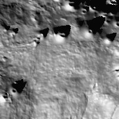
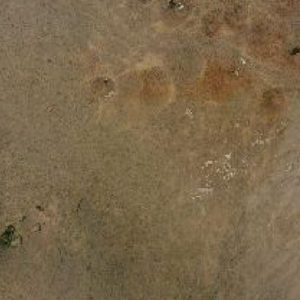

# Field brief · Mauna Kea / Mauna Loa saddle

**Best 6 km window:** 19.8110, -155.5443 · [Google Maps](https://www.google.com/maps/@19.811,-155.54434,13z) · [NASA Worldview](https://worldview.earthdata.nasa.gov/?v=-155.744,19.611,-155.344,20.011)  
**Region:** Mauna Kea / Mauna Loa saddle, Hawaiʻi (US)

## Why here

Rank of this region's best window for each Moon Base site, among all Earth windows (6 km).

| Moon Base site | Rank | Combined | Terrain | Illumination | Window centre |
|---|---|---|---|---|---|
| Shackleton Connecting Ridge | #1 of 10,424 (best on Earth) | 91 | 89 | 98 | 19.811, -155.544 |
| Nobile Rim 1 | #1 of 10,424 (best on Earth) | 80 | 78 | 95 | 19.865, -155.516 |
| de Gerlache Rim | #1 of 10,424 (best on Earth) | 85 | 83 | 92 | 19.865, -155.516 |
| Malapert Massif | #1 of 10,424 (best on Earth) | 79 | 76 | 91 | 19.784, -155.487 |
| Haworth | #1 of 10,424 (best on Earth) | 89 | 90 | 87 | 19.459, -155.516 |
| Leibnitz Beta Plateau | #1 of 10,424 (best on Earth) | 85 | 84 | 91 | 19.296, -155.830 |

Images and the lines below are for the window best matched to Shackleton Connecting Ridge.

**Similar in:** local relief, median slope, steep-slope fraction (P90), 150 m roughness, hypsometry, shadow at 2° sun, shadow at 5° sun  
**Differs in:** nothing beyond 1.5 IQR

## When to go

Best 14-day campaign block: **10 Dec 2026 – 23 Dec 2026**, with 67 min/day of Sun 0–7° above the horizon. The calendar file [`earth_hawaii_mauna_kea.ics`](earth_hawaii_mauna_kea.ics) has its 28 low-Sun windows (times in UTC; calendar apps convert); [`earth_hawaii_mauna_kea_lowsun_windows.csv`](earth_hawaii_mauna_kea_lowsun_windows.csv) lists every window of the year.

| Month | Sun 0–7° (min/day) |
|---|---|
| Dec 2026 | 66 |
| Jan 2027 | 65 |
| Feb 2027 | 62 |
| Mar 2027 | 60 |
| Apr 2027 | 60 |
| May 2027 | 63 |
| Jun 2027 | 65 |
| Jul 2027 | 64 |
| Aug 2027 | 61 |
| Sep 2027 | 60 |
| Oct 2027 | 61 |
| Nov 2027 | 64 |

## Where the analogy breaks

- Diviner: 99.8% of Shackleton Connecting Ridge has an annual mean temperature (2 cm below the surface) below Earth's record low (184 K); water ice is stable within 1 m in 35% of it.
- Gravity 1 g vs 1/6 g; atmosphere, weather and vegetation vs hard vacuum; no anorthosite highland regolith.
- Real low Sun on Earth comes only from the east (morning) or west (evening) at this latitude, except near the poles.

## Field safety (NASA EONET)

Open natural events within 150 km in the snapshot of 2026-11-14 20:56 UTC (check again before travel):

- Wildfire KAWAIHAE ROAD, Hawaii, Hawaii (Wildfires, 2026-07-26, ~35 km)
- MANA ROAD Wildfire, Hawaii, Hawaii (Wildfires, 2025-11-07, ~20 km)
- Kilauea Volcano, Hawaii (Volcanoes, 2024-12-23, ~51 km)

*Generated by `scripts/extras/campaign_calendar.py` from P.E.N. outputs. Solar times: NOAA algorithm, no refraction (refraction adds ~0.5° near the horizon, shifting windows by a few minutes).*
