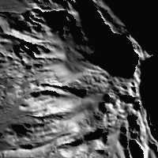
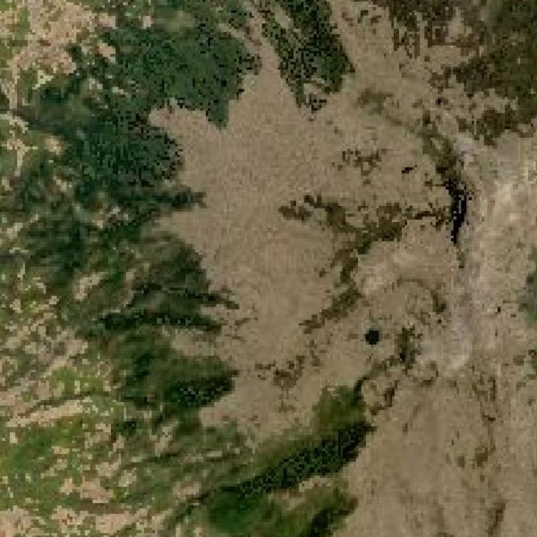

# Field brief · Serdán-Oriental basin maars & domes

**Best 6 km window:** 19.4855, -97.1728 · [Google Maps](https://www.google.com/maps/@19.4855,-97.17277,13z) · [NASA Worldview](https://worldview.earthdata.nasa.gov/?v=-97.373,19.285,-96.973,19.685)  
**Region:** Serdán-Oriental basin maars & domes, Puebla (MX)

## Why here

Rank of this region's best window for each Moon Base site, among all Earth windows (6 km).

| Moon Base site | Rank | Combined | Terrain | Illumination | Window centre |
|---|---|---|---|---|---|
| Malapert Massif | #2 of 10,424 (top 0.1 %) | 77 | 78 | 76 | 19.485, -97.173 |

Images and the lines below are for the window best matched to Malapert Massif.

**Similar in:** local relief, median slope, steep-slope fraction (P90), 150 m roughness, hypsometry, shadow at 2° sun, shadow at 5° sun  
**Differs in:** nothing beyond 1.5 IQR

## When to go

Best 14-day campaign block: **12 Dec 2026 – 25 Dec 2026**, with 66 min/day of Sun 0–7° above the horizon. The calendar file [`earth_mx_serdan_oriental.ics`](earth_mx_serdan_oriental.ics) has its 28 low-Sun windows (times in UTC; calendar apps convert); [`earth_mx_serdan_oriental_lowsun_windows.csv`](earth_mx_serdan_oriental_lowsun_windows.csv) lists every window of the year.

| Month | Sun 0–7° (min/day) |
|---|---|
| Dec 2026 | 66 |
| Jan 2027 | 65 |
| Feb 2027 | 60 |
| Mar 2027 | 60 |
| Apr 2027 | 60 |
| May 2027 | 63 |
| Jun 2027 | 65 |
| Jul 2027 | 64 |
| Aug 2027 | 61 |
| Sep 2027 | 61 |
| Oct 2027 | 61 |
| Nov 2027 | 64 |

## Where the analogy breaks

- Diviner: 87.9% of Malapert Massif has an annual mean temperature (2 cm below the surface) below Earth's record low (184 K); water ice is stable within 1 m in 22% of it.
- Gravity 1 g vs 1/6 g; atmosphere, weather and vegetation vs hard vacuum; no anorthosite highland regolith.
- Real low Sun on Earth comes only from the east (morning) or west (evening) at this latitude, except near the poles.

## Field safety (NASA EONET)

No open natural events within 150 km in the snapshot of 2026-11-14 20:56 UTC.

*Generated by `scripts/extras/campaign_calendar.py` from P.E.N. outputs. Solar times: NOAA algorithm, no refraction (refraction adds ~0.5° near the horizon, shifting windows by a few minutes).*
